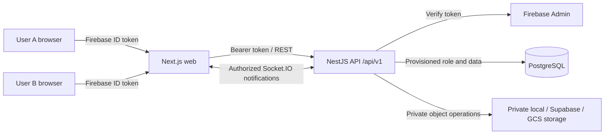

# Company Collaboration Platform

A two-person company workspace built with Next.js, Firebase Authentication, NestJS, Prisma, and PostgreSQL. A provisioned owner maintains the company record; the assigned collaborator reads it and uploads private images. Authentication and authorization are enforced independently by the API.

## Architecture



## Implemented functionality

- Firebase email/password sign-in; there is no public registration flow.
- Active, database-provisioned `USER_A` and `USER_B` roles; unknown or inactive Firebase identities are denied.
- Owner-only company updates and assigned collaborator read access.
- Shared frontend/backend percentage calculation, validated and recalculated by the API.
- Private image uploads with size and content-signature checks; image metadata is stored in PostgreSQL and image bytes in private storage.
- Authenticated Socket.IO connections and minimal company/image update notifications.
- Versioned REST endpoints, liveness/readiness checks, API throttling, CORS, Helmet, request IDs, and structured exception responses.

## Roles and API permissions

| Endpoint | Public | USER_A | USER_B |
|---|---:|---|---|
| `GET /api/v1/health/live` | Yes | Yes | Yes |
| `GET /api/v1/health/ready` | Yes | Yes | Yes |
| `GET /api/v1/auth/me` | No | Own profile | Own profile |
| `GET /api/v1/company/me` | No | Own company | Assigned company |
| `PUT /api/v1/company/me` | No | Create/update | 403 |
| `GET /api/v1/collaborator/company/latest` | No | 403 | Assigned company |
| `GET /api/v1/company/me/images` | No | Assigned images | Assigned images |
| `POST /api/v1/company/me/images` | No | 403 | Upload to assigned company |
| `GET /api/v1/company/me/images/:id/access` | No | Assigned images | Assigned images |

Company history and image deletion are intentionally not exposed because they are not implemented. Image listing supports `page` and `limit` query parameters.

## Percentage

The documented formula is:

```text
numberOfUsers / (numberOfUsers + numberOfProducts) * 100
```

The shared pure function in `packages/domain` rounds to one decimal place for storage and display and returns zero when both counts are zero. Both counts must be integers from 0 through 10,000,000. The backend calculates the value and stores it as PostgreSQL `DECIMAL(5,1)`; client-submitted percentages are rejected.

## Stack and repository layout

- Frontend: Next.js App Router, React, strict TypeScript, Tailwind CSS, React Hook Form, Zod, Firebase client SDK, Socket.IO client, Jest, React Testing Library.
- Backend: NestJS, Prisma, PostgreSQL, Firebase Admin, DTO validation, Jest, Supertest, Socket.IO, Helmet, throttling.
- `apps/web`: browser application.
- `apps/api`: API, Prisma schema, migrations, controlled seed.
- `packages/domain`: shared percentage logic.
- `bruno`: importable API collection and local environment template.
- `docs`: architecture, security, deployment, and testing guides.

## Local setup

Prerequisites: Node.js 20+, npm, and PostgreSQL (or Docker for the included local database).

1. Copy `apps/api/.env.example` to `apps/api/.env`; copy `apps/web/.env.example` to `apps/web/.env.local`.
2. Configure the Firebase project ID, Firebase Admin credentials, web SDK values, and PostgreSQL connection. The public `NEXT_PUBLIC_*` variables belong only in the web env file. Never place database credentials or Firebase Admin credentials in frontend configuration.
3. Start local PostgreSQL and install dependencies:

   ```powershell
   docker compose up -d postgres
   npm install
   npm run db:generate
   npm run db:deploy
   ```

4. Provision the two internal user roles using an authenticated Firebase Admin environment. Set `APP_OWNER_UID` and `APP_COLLABORATOR_UID` to existing Firebase UIDs, or configure the seed email/password variables for accounts that should be created if missing. Existing Firebase passwords are never changed by the seed:

   ```powershell
   npm run db:seed
   ```

5. Start API and web:

   ```powershell
   npm run dev
   ```

Open `http://localhost:3000`. The API is at `http://localhost:4000/api/v1`; liveness is `/health/live`, readiness is `/health/ready`, and Swagger UI is `/docs`.

### Firebase setup and provisioning

Enable Email/Password in Firebase Authentication and add `localhost` to authorized domains. Configure the web app’s `apiKey`, `authDomain`, `projectId`, and `appId` in `apps/web/.env.local`. Configure the same Firebase project ID for the API. For local Admin verification, use Application Default Credentials or keep a Firebase Admin service-account JSON outside the repository and set `FIREBASE_SERVICE_ACCOUNT_JSON` only in the API environment. Never use a Firebase web API key as an Admin credential.

The controlled seed accepts `SEED_USER_A_EMAIL`/`SEED_USER_A_PASSWORD` and `SEED_USER_B_EMAIL`/`SEED_USER_B_PASSWORD`. It retrieves existing accounts by email without modifying their passwords, creates accounts only when missing, and refuses conflicting existing role records. Alternatively, set the corresponding `APP_OWNER_UID` and `APP_COLLABORATOR_UID` to retrieve existing Firebase accounts by UID. Unknown Firebase UIDs are not automatically provisioned at sign-in.

## Database and storage

The Prisma schema defines unique Firebase users, one company-owner and collaborator relationship, decimal percentage storage, and image metadata relations. Migrations are versioned under `apps/api/prisma/migrations`.

- Generate Prisma Client: `npm run db:generate`
- Apply committed migrations: `npm run db:deploy`
- Create a local development migration: `npm run db:migrate`
- Provision development users: `npm run db:seed`

Do not use a destructive database reset against production. Local images are private files under `.data/private-images`; production configuration must use a private Supabase Storage or GCS bucket. No uploaded image bytes are stored in PostgreSQL or in public web assets. Cloud reads are authorized by the API and use short-lived signed URLs.

## Bruno API collection

Open the `bruno/` folder in Bruno and select the `Local` environment. Set `ownerFirebaseIdToken` and `collaboratorFirebaseIdToken` locally to short-lived Firebase ID tokens. Do not commit tokens. Requests document the owner/collaborator behavior, including forbidden operations. Run only against a configured API/database. The collection examples are templates and are not claimed as live production responses.

## Tests and checks

```powershell
npm test
npm run test:api
npm run test:web
npm --workspace @company-platform/api run test:e2e
npm --workspace @company-platform/api run lint
npm --workspace @company-platform/web exec tsc -- --noEmit
npm run build
```

The e2e authorization suite uses a Nest testing module and mocked Firebase verification; it is not a live Firebase/PostgreSQL integration test. See [docs/testing.md](./docs/testing.md) for limitations and manual verification.

## Deployment and security

See [docs/architecture.md](./docs/architecture.md), [docs/security.md](./docs/security.md), [docs/deployment.md](./docs/deployment.md), and [docs/testing.md](./docs/testing.md). The repository includes a Render/Vercel/Supabase deployment path and optional Cloud Run configuration, but no live deployment is claimed. Verify production authentication, database migrations, private image access, CORS, and WebSocket behavior against the actual services before treating deployment as complete.

## Known limitations

- No live cloud deployment, provisioned test-account credentials, or production URLs are included.
- Real Firebase and PostgreSQL integration tests require separately configured services; local unit/e2e tests do not prove hosted behavior.
- History and image deletion endpoints are omitted rather than returning fabricated data or implying unsupported deletion.
- Storage and deployment settings must be configured for the selected environment; production must not use local filesystem storage.
