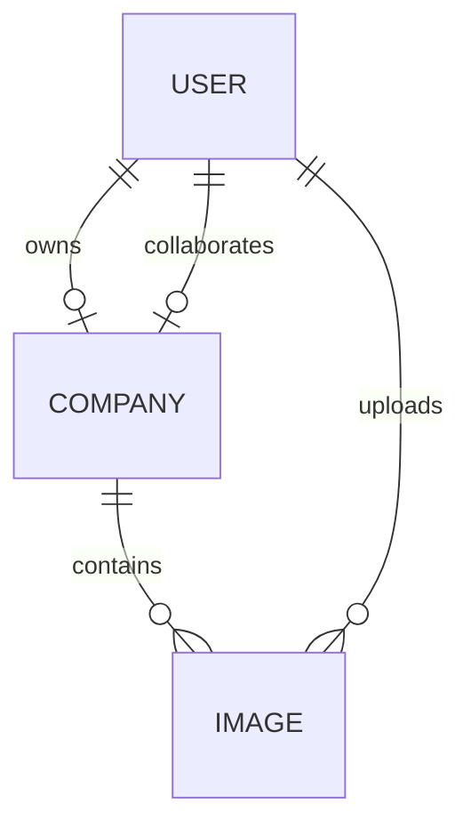

# Architecture

## Components

- `apps/web` is a strict-TypeScript Next.js App Router client. Firebase Auth handles email/password sign-in; a typed API helper attaches the current Firebase ID token to every Nest request. React Hook Form and Zod validate the owner form. Socket.IO refreshes the shared view after company submissions and uploads.
- `apps/api` is a NestJS REST API under `/api/v1` with Prisma/PostgreSQL, Firebase Admin token verification, database-provisioned user roles, DTO validation, role guards, throttling, Helmet, readiness/liveness checks, and a Socket.IO namespace.
- PostgreSQL stores one `Company` per configured owner UID and image metadata. Image bytes are stored in a private local directory in development, a private Supabase Storage bucket on the Render deployment, or a private GCS bucket for the optional Cloud Run deployment.

## Request flow

1. Firebase authenticates the email/password account and the browser receives an ID token.
2. The API verifies the token signature, audience/project, expiry, and revocation state with Firebase Admin, then loads an active internal user row by verified Firebase UID. Roles are never inferred from client input.
3. Nest guards enforce `USER_A`/`USER_B`. User A alone can upsert the associated company. The assigned User B can read it and upload; image listing and access use the authenticated user's database relationship.
4. Uploaded content is limited to 5 MiB and JPEG/PNG/WebP signatures are checked before storing. The database receives the storage key and metadata, never the bytes.
5. Authorized image reads are checked against the configured owner company. Local mode streams from a private path; Supabase and GCS modes redirect to a signed read URL expiring after two minutes.
6. Authenticated sockets join only the room for their database-assigned company. Successful writes emit minimal `company.updated` or `image.uploaded` notifications; clients fetch fresh data through REST.

## Percentage

`percentage = round((users / (users + products)) * 100, 1)`. It is `0` when both counts are zero. The UI preview and API persistence use the shared pure function in `packages/domain`; the API persists the result as `Decimal(5,1)`. Counts are non-negative integers capped at 10,000,000.

## Data relationships

`User.firebaseUid` and `User.email` are unique; `User.role` is the database-controlled `USER_A` or `USER_B` value and inactive users are rejected. Each company has unique owner and collaborator references. Images belong to a company and record an uploader reference; storage keys remain server-side.

